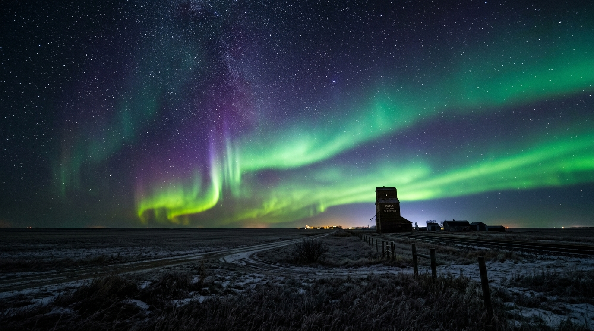

  
  

    FIG 01 // Northern Lights (Aurora Borealis) at 50.1° N, Western Manitoba
    OCTOBER 24, 2026 • 02:14 AM
  

  

    ★ CAPTURE METADATA & OPTICAL TELEMETRY
    EXIF SPECIFICATION
  

  

    

      CAMERA BODY
      Leica M10-R (Rangefinder)
    

    

      LENS
      Voigtländer 21mm f/1.4 Nokton
    

    

      FOCAL LENGTH
      21 mm
    

    

      APERTURE
      f/1.4 (Wide Open)
    

    

      EXPOSURE TIME
      8.0 Seconds
    

    

      ISO SENSITIVITY
      ISO 1600
    

    

      SUPPORT
      Gitzo Mountaineer Carbon Tripod
    

  

### The Field Dispatch

At 11:30 PM, NOAA space weather telemetry indicated a coronal mass ejection (CME) shock front impacting Earth's magnetosphere, spiking planetary K-index readings to **7.8**. Leaving the workshop in Brandon, I drove north along gravel grid roads toward the Assiniboine River valley.

At -18°C, the air was crystal clear and completely devoid of atmospheric haze. By 1:45 AM, what began as a faint milky arc along the northern horizon violently erupted into dynamic, pulsing corona curtains. 

### Optical & Exposure Considerations

Fast sub-minute exposures are paramount when photographing dynamic auroral substorms. At exposures longer than 10 seconds, the rapid vertical dancing of proton rays turns into a smeared green mush. 

By utilizing the **Voigtländer 21mm f/1.4 Nokton** wide open at f/1.4, I was able to gather enough photons to keep the shutter speed clamped to **8 seconds at ISO 1600**, freezing the delicate violet filament fringes at the top of the curtains while preserving pinpoint stars without star-trailing artifacts.

Framing the 1920s wooden grain elevator against the lower horizon grounded the composition, contrasting century-old prairie agrarian craftsmanship against cosmic solar physics.
