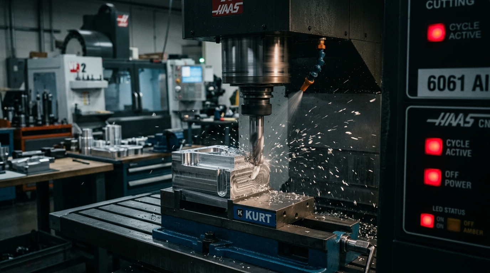

<div class="photo-feature-figure">
  
  <div class="photo-feature-caption">
    <span>BUILD LOG #042 // Haas VF-2 & Custom Gantry Mill • 6061-T6 Aerospace Billet</span>
    <span>SPINDLE LOAD: 42% • 18,000 RPM</span>
  </div>
</div>

Machining aluminum on light industrial CNC mills or high-rigidity router gantries is one of the most rewarding milestones in digital fabrication. However, 6061-T6 is notorious for gummy chip welding when heat builds up in the cut zone. If your chip isn't thick enough to evacuate thermal energy away from the tool edge, you will friction-weld aluminum into your flutes in under two seconds.

Here is the exact formula, tooling geometry, and toolpath strategy I use to achieve mirror floor finishes and aggressive material removal rates (MRR) without tool chatter.

---

## ⚙️ Machining Parameters & Tooling Selection

<div class="exif-card">
  <div class="exif-header">
    <span>CUT DATA // ADAPTIVE CLEARING</span>
    <span>6061-T6 BILLET</span>
  </div>
  <div class="exif-grid">
    <div class="exif-item">
      <span class="exif-label">ENDMILL</span>
      <span class="exif-value">1/4" (6.35mm) Single-Flute DLC Coated Carbide</span>
    </div>
    <div class="exif-item">
      <span class="exif-label">SPINDLE SPEED</span>
      <span class="exif-value">18,000 RPM</span>
    </div>
    <div class="exif-item">
      <span class="exif-label">FEED RATE</span>
      <span class="exif-value">2,200 mm/min (86.6 IPM)</span>
    </div>
    <div class="exif-item">
      <span class="exif-label">OPTIMAL LOAD (Ae)</span>
      <span class="exif-value">1.1 mm (17.3% Tool Diameter)</span>
    </div>
    <div class="exif-item">
      <span class="exif-label">AXIAL DEPTH (Ap)</span>
      <span class="exif-value">12.0 mm (1.89x Tool Diameter)</span>
    </div>
    <div class="exif-item">
      <span class="exif-label">CHIP LOAD (Fz)</span>
      <span class="exif-value">0.061 mm/tooth (adjusted for chip thinning)</span>
    </div>
  </div>
</div>

---

## 🧮 Calculating Radial Chip Thinning

When taking light radial cuts (typically less than 50% tool diameter in modern adaptive/trochoidal clearing), the chip thickness is geometrically smaller than the linear feed per tooth:

$$h_{max} = f_z \cdot \sqrt{\frac{A_e}{D}}$$

Where:
- $h_{max}$ = Actual maximum chip thickness desired ($0.05 - 0.08\text{ mm}$ for aluminum)
- $f_z$ = Programmed feed per tooth
- $A_e$ = Radial width of cut ($1.1\text{ mm}$)
- $D$ = Cutter diameter ($6.35\text{ mm}$)

If you program $0.05\text{ mm}$ feed per tooth without adjusting for radial chip thinning at $A_e = 1.1\text{ mm}$, your actual chip thickness drops below $0.02\text{ mm}$. At that thickness, the cutter rubs rather than shears, creating work hardening and catastrophic tool weld.

```gcode
( TOOL: 1/4 INCH 1-FLUTE DLC FLAT ENDMILL )
( OPERATION: 2D ADAPTIVE TROCHOIDAL POCKET )
G90 G94 G17 G21
G54
M08 ( AIR BLAST / MIST ON )
S18000 M03
G00 X45.210 Y12.450
G43 H01 Z15.000
G00 Z2.000
G01 Z-12.000 F650.0 ( HELICAL ENTRY RAMP 2.5 DEG )
G01 X46.850 Y14.120 F2200.0
G03 X47.500 Y15.500 I0.650 J1.380 F2200.0
```

---

## 💡 Minimum Quantity Lubrication (MQL) Setup

Flood coolant is messy and requires enclosed catch basins. For open or semi-enclosed maker shops, a pressurized Fogbuster or DIY air-blast atomizing isopropyl alcohol or plant-based ester oil at 40 PSI is unbeatable:
1. **Evacuation:** The 40 PSI air stream blasts hot chips clear of deep pockets so the endmill never recuts chips.
2. **Latent Heat of Vaporization:** Alcohol flashes off upon contact with the cutter, instantly dropping the tool temperature to ambient without leaving slippery oil puddles.
