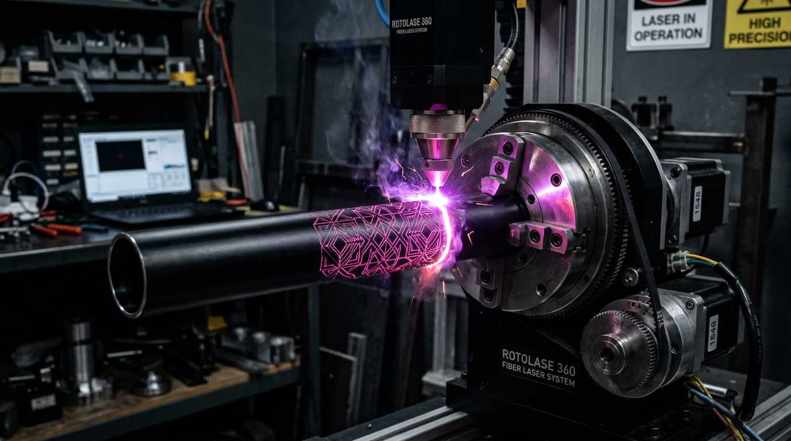

<div class="photo-feature-figure">
  
  <div class="photo-feature-caption">
    <span>BUILD LOG #041 // 50W JPT M7 MOPA Fiber Laser • Rotolase 360 Chuck</span>
    <span>PULSE DURATION: 60ns • FREQUENCY: 45 kHz • BEAM SPOT: 25µm</span>
  </div>
</div>

Unlike Q-switched fiber lasers that are locked to fixed pulse durations (~100–200ns), a MOPA (Master Oscillator Power Amplifier) architecture gives you independent control over pulse duration (2ns to 500ns) and repetition rate (up to 4000 kHz). This flexibility opens up deep 2.5D coin-relief carving into tool steel, non-destructive black marking on medical-grade aluminum, and vivid color annealing on grade 5 titanium.

In this log, we break down rotary setup, hatch optimization, and parameter matrices in LightBurn for high-resolution cylindrical laser marking.

---

## ⚡ Laser Parameter Matrix: Deep Engraving vs. Cleaning Pass

<div class="exif-card">
  <div class="exif-header">
    <span>LAYER SETTINGS // 50W JPT MOPA</span>
    <span>ANODIZED ALUMINUM & TITANIUM</span>
  </div>
  <div class="exif-grid">
    <div class="exif-item">
      <span class="exif-label">DEEP CUT SPEED</span>
      <span class="exif-value">800 mm/s (45 passes, 90° cross-hatch)</span>
    </div>
    <div class="exif-item">
      <span class="exif-label">POWER (DEEP)</span>
      <span class="exif-value">90% (45 Watts peak pulse)</span>
    </div>
    <div class="exif-item">
      <span class="exif-label">PULSE DURATION</span>
      <span class="exif-value">200 ns (maximum kinetic shockwave)</span>
    </div>
    <div class="exif-item">
      <span class="exif-label">HATCH LINE SPACING</span>
      <span class="exif-value">0.035 mm (optimized for 25µm spot)</span>
    </div>
    <div class="exif-item">
      <span class="exif-label">POLISH PASS SPEED</span>
      <span class="exif-value">2,200 mm/s (Power: 25%, Pulse: 15ns)</span>
    </div>
    <div class="exif-item">
      <span class="exif-label">ROTARY RATIO</span>
      <span class="exif-value">3.00:1 planetary belt reduction (3200 steps/rev)</span>
    </div>
  </div>
</div>

---

## 🔄 Rotary Chuck Integration & Axis Calibration

Engraving around curved cylindrical profiles requires zero slip and precise diameter scaling. When marking continuous seamless textures (such as geometric knurling or 360-degree helical vectors), any backlash in the rotary gearbox causes visible seam overlaps:

1. **Steps Per Rotation:** Calibrate your stepper driver microstepping (typically 16x microstepping on an 8-lead hybrid NEMA 23 stepper yields $3200\text{ steps/rev} \times \text{gear ratio}$).
2. **Split Size vs. Focal Depth:** Set your LightBurn "split size" to $0.05\text{ mm} - 0.15\text{ mm}$. Larger splits cause the galvanometer mirrors to sweep beyond the focal plane of the cylinder, defocusing the beam and losing energy density.
3. **Focal Plane Compensation:** Keep the telecentric F-Theta lens exactly centered over the top dead center (TDC) of the tube using a digital depth gauge.

```bash
# LightBurn Rotary Settings Quick Reference:
Chuck Diameter: 65.0 mm
Object Diameter: 32.1 mm
Circumference: 100.84 mm
Line Shift per Split: 0.08 mm
Acceleration: 1500 mm/s^2
```

---

## 🎨 Titanium Color Spectrum Through Thermal Oxide Layers

By varying pulse frequency between 120 kHz and 350 kHz and reducing power to 30%, you induce controlled thermal oxide growth without boiling the substrate. The specific oxide thickness creates thin-film optical interference, refracting light into vibrant blues, magentas, and deep golds directly on titanium and stainless steel.
