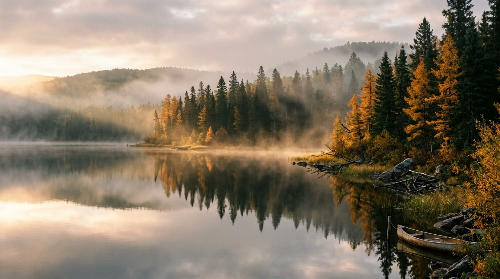

  
  

    FIG 01 // Autumn Dawn Mist, Clear Lake Shoreline, Riding Mountain National Park
    OCTOBER 19, 2026 • 07:08 AM
  

  

    ★ CAPTURE METADATA & OPTICAL TELEMETRY
    EXIF SPECIFICATION
  

  

    

      CAMERA BODY
      Fujifilm GFX 100S (Medium Format 102MP)
    

    

      LENS
      Fujinon GF 45-100mm f/4 R LM OIS WR
    

    

      FOCAL LENGTH
      68 mm (approx. 54mm full-frame eq.)
    

    

      APERTURE
      f/8.0 (Sweet Spot Resolution)
    

    

      SHUTTER SPEED
      1/60s (Electronic Front Curtain)
    

    

      ISO SENSITIVITY
      ISO 200 (Base Native)
    

    

      FILTER
      B+W Käsemann Circular Polarizer MRC Nano
    

  

### The Quiet Hour

There is a brief twenty-minute window when the sun breaks above the eastern escarpment of the Manitoba parkland, hitting cool autumn air sitting over the lake. Moisture condensates into rolling tendrils of steam and low fog that snake between the black spruce needles.

Paddling an 16-foot cedar canvas canoe into position required absolute stillness. Any paddle stroke ripples the glass reflection of the shoreline trees.

### Resolving Boreal Micro-Textures

The 44x33mm medium format sensor of the GFX 100S rendered individual needles on the distant larches and the fibrous wood grain of the drifted cedar log with unbelievable fidelity. Using a Käsemann circular polarizer rotated to roughly 45% efficiency allowed me to cut surface glare from the near water while preserving the mirror reflection of the distant ridge.
