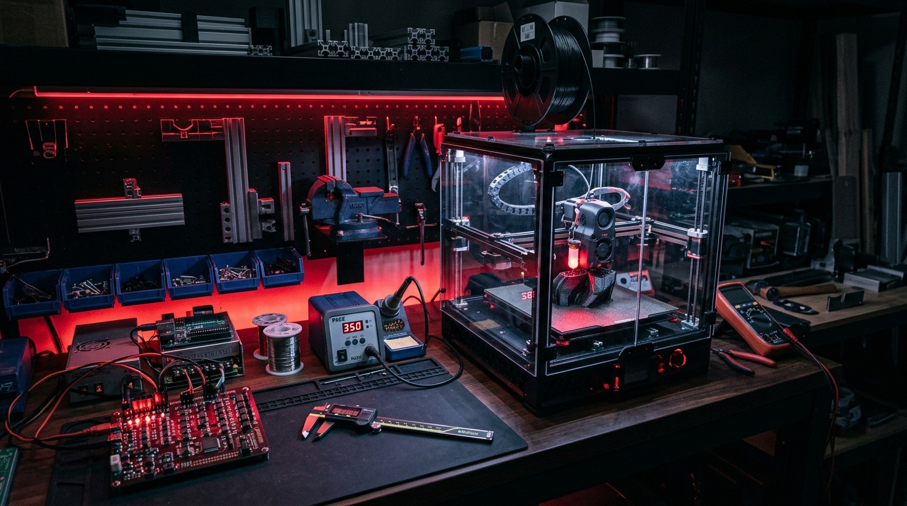

<div class="photo-feature-figure">
  
  <div class="photo-feature-caption">
    <span>BUILD LOG #039 // Custom Enclosed Voron 2.4 350mm³ • Heated Chamber</span>
    <span>HOTEND: 295°C • BED: 110°C • CHAMBER: 58°C • NOZZLE: 0.6mm HARDENED STEEL</span>
  </div>
</div>

For holding odd-geometry castings or delicate machined housings in a Kurt CNC vise, aluminum soft jaws take valuable machining time and machine availability. By tuning a high-temperature CoreXY 3D printer to reliably extrude carbon-fiber-reinforced nylon (PA6-CF / PA12-CF), you can print high-rigidity, custom contour-conforming vice jaws overnight that hold tolerances within $\pm 0.02\text{ mm}$.

Here is the hardware configuration, slicing recipes, and annealing procedure required to prevent warping and maximize interlaminar shear strength.

---

## 🛠️ Machine Specifications & Extrusion Hardware

<div class="exif-card">
  <div class="exif-header">
    <span>PRINTER ARCHITECTURE // KLIPPER FIRMWARE</span>
    <span>PA-CF ENGINEERING BUILD</span>
  </div>
  <div class="exif-grid">
    <div class="exif-item">
      <span class="exif-label">KINEMATICS</span>
      <span class="exif-value">CoreXY with flying gantry (Quad Gantry Leveling)</span>
    </div>
    <div class="exif-item">
      <span class="exif-label">HOTEND</span>
      <span class="exif-value">Rapido 2 UHF (70W Ceramic Heater, PT1000 RTD)</span>
    </div>
    <div class="exif-item">
      <span class="exif-label">NOZZLE TYPE</span>
      <span class="exif-value">0.6mm DiamondBack Polycrystalline Diamond (PCD)</span>
    </div>
    <div class="exif-item">
      <span class="exif-label">FILAMENT DRYING</span>
      <span class="exif-value">Active 85°C desiccant blast drybox during printing</span>
    </div>
    <div class="exif-item">
      <span class="exif-label">PRINT SPEED</span>
      <span class="exif-value">120 mm/s (Acceleration: 7,500 mm/s² with Input Shaping)</span>
    </div>
    <div class="exif-item">
      <span class="exif-label">PART COOLING</span>
      <span class="exif-value">0% fan (maximum layer cohesion)</span>
    </div>
  </div>
</div>

---

## 🔬 Slicing Strategies for Heavy Machine Jigs

Standard decorative 3D printing settings (2 perimeters, 15% grid infill) will instantly collapse under the clamping torque of a hydraulic machine vise. For functional tooling:

1. **Walls Over Infill:** Use 6 to 8 perimeters. 90% of tensile and compression stiffness in a beam comes from the outer skin.
2. **Gyroid Infill at 45%:** Gyroid infill distributes clamping forces isotropically, avoiding directional shear planes.
3. **Continuous Fiber Alignment:** Carbon fibers orient along the extrusion direction. Align toolpaths parallel to your vise clamping vectors for maximum compressive yield strength.

```ini
; SuperSlicer / OrcaSlicer Config Excerpt
layer_height = 0.28
first_layer_height = 0.32
perimeters = 7
top_solid_layers = 6
bottom_solid_layers = 6
fill_density = 45%
fill_pattern = gyroid
extrusion_width = 0.68
temperature = 295
bed_temperature = 110
chamber_temperature = 55
```

---

## 🔥 Annealing & Moisture Conditioning Protocol

PA6-CF straight off the print bed has high residual thermal stresses:
- **Oven Anneal:** Bake the fixture at 90°C for 2 hours, ramp to 130°C for 4 hours, then slow cool inside the oven over 6 hours. This increases crystallinity from ~20% to ~38%, doubling heat deflection temperature (HDT) to over 190°C.
- **Moisture Normalization:** Nylon naturally absorbs atmospheric water, which softens the polymer chains and dramatically increases impact toughness, preventing brittle fracture under heavy milling cutter vibration.
