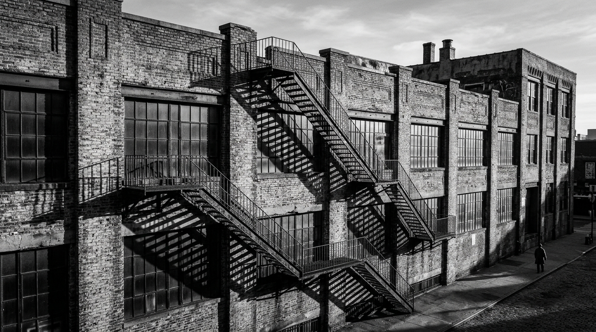

  
  

    FIG 01 // Geometric Shadows on Century Brick, Pacific Avenue Warehouse District
    OCTOBER 16, 2026 • 11:40 AM
  

  

    ★ CAPTURE METADATA & OPTICAL TELEMETRY
    EXIF SPECIFICATION
  

  

    

      CAMERA BODY
      Leica M Monochrom (Typ 246)
    

    

      SENSOR
      Dedicated Monochrome CMOS (No Bayer CFA)
    

    

      LENS
      Leica Summicron-M 35mm f/2 ASPH
    

    

      OPTICAL FILTER
      B+W Dark Yellow/Orange (040) MRC
    

    

      APERTURE
      f/5.6
    

    

      SHUTTER SPEED
      1/500s
    

    

      ISO SENSITIVITY
      ISO 320 (Base Monochrom)
    

  

### Monochrome Light Without Demosaicing

Because a dedicated monochrome sensor lacks a Bayer color filter array (CFA), it requires zero software color demosaicing or mathematical interpolation to determine luminance. Every single pixel on the silicon directly records pure photon intensity.

The consequence is an astonishing micro-contrast that renders each individual lime mortar joint, weathered brick face, and cold-rolled steel rivet on the fire escape with razor-like clarity.

### Optical Filtering with Orange Glass

Shooting through a **B+W 040 Dark Orange optical filter** darkened the blue sky and atmospheric reflections off the window glass by approximately 1.5 stops, elevating the contrast of the cast diagonal shadow steps against the warm red brick.
